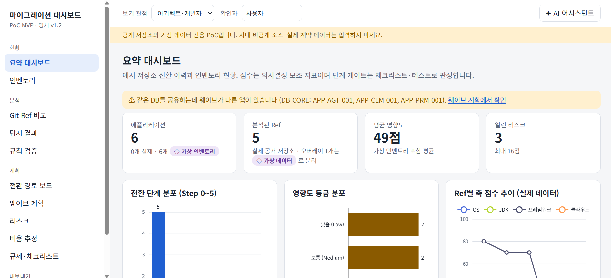

# 클라우드 마이그레이션 대시보드 (PoC MVP)

기술명세서 v1.2 구현. React 19 + Vite(TypeScript) 정적 프런트엔드, Vercel Functions 2개(`/api/scan`, `/api/ai`), Claude API. 별도 백엔드·DB 없음 — 사용자 작업 상태는 브라우저 저장소에 두고 JSON으로 내보내기/가져오기합니다.

> 공개 저장소와 가상 데이터 전용입니다. 사내 비공개 소스·실제 계약 데이터는 입력하지 마세요.

## 저장소 자동 분석 (저장소 분석 화면)

공개 GitHub 저장소 URL(예: `https://github.com/owner/repo`, `.../tree/브랜치` 형식 포함)을 입력하고 **분석 시작**을 누르면 자동으로 진행됩니다.

1. 저장소 확인 — 공개 여부, 기본 브랜치, 브랜치·태그 목록 (`POST /api/scan {action:"refs"}`)
2. 소스 수신·규칙 엔진 실행 — 해당 커밋의 아카이브를 메모리에서만 해제 (`POST /api/scan`, Ref 생략 시 기본 브랜치)
3. 결과 반영 — 저장소당 앱 1개(`GH-owner__repo`)와 Ref를 자동 등록하고 영향도·추정 Step·상위 탐지 규칙 표시

URL이 없으면 소스 구조 유사성 기준의 **예시 저장소 5개**(practice-spring-study, egovframe-web-sample 4.1.x, egovframe-runtime, awesome-egovframe, spring-integration-samples)에서 고를 수 있습니다. 같은 저장소의 다른 브랜치·태그를 이어서 분석하면 같은 앱의 Ref로 추가되어 Git Ref 비교에서 전환 이력을 볼 수 있습니다. 탐지가 많은 저장소는 규칙당 최대 200건만 브라우저에 보관하되 점수는 전체 건수(`ruleCounts`)로 계산합니다.

## 빠른 시작

```bash
npm install
cp .env.example .env.local    # ANTHROPIC_API_KEY, GITHUB_TOKEN 입력 (둘 다 선택)
npm run dev                   # http://localhost:5173  (규칙 빌드 + Vite, /api/* 도 함께 서빙)
```

- AI 기능은 `ANTHROPIC_API_KEY` 가 있어야 동작합니다. 키가 없으면 AI 버튼은 오류 안내만 표시하고 나머지 기능은 정상 동작합니다.
- 스냅샷 모드(기본)는 키·네트워크 없이 `public/data/snapshots/` 의 정적 JSON을 읽습니다.
- **`VITE_` 접두어를 환경변수에 붙이지 마세요.** 클라이언트 번들에 포함되어 키가 노출됩니다 (`npm test` 가 `dist/` 를 검사합니다).

## 명령

| 명령 | 설명 |
|---|---|
| `npm run dev` | 개발 서버 (`api/*.ts` 를 로컬에서 그대로 실행) |
| `npm run build` | 규칙 JSON 생성 → 타입체크 → Vite 빌드 |
| `npm run build:rules` | `rules/*.yaml` → `public/data/rules.json` (규칙 내용 해시로 `rulesetVersion` 생성) |
| `npm run snapshot` | 고정 SHA 스캔·Ref 간 diff를 `public/data/snapshots/` 에 생성 (`--only 4.1.x` 지원) |
| `npm test` | Vitest: 규칙 엔진, 14.4절 회귀(고정 SHA), 점수·게이트·비용, AI 가드레일(마스킹·캐시·스키마), 번들 키 노출 검사 |

## Vercel 배포

1. 저장소를 Vercel에 연결 (Framework: Vite). `git push` 마다 Preview 배포가 생성됩니다.
2. 환경변수 설정: `ANTHROPIC_API_KEY`, `GITHUB_TOKEN`(공개 저장소 읽기 권한만), 선택 `AI_MODEL_DEFAULT`, `AI_MODEL_FAST`, `AI_MAX_TOKENS`, `APP_ACCESS_CODE`.
3. 프로젝트 설정에서 Deployment Protection을 켜고, 함수 리전은 `vercel.json` 의 `icn1`(서울)을 사용합니다.

## 구조

```
api/            scan.ts, ai.ts, _lib/ (github, redact, guard, anthropic, rules)
prompts/        system.md, tasks/*.md, schemas/*.json, context/spec-excerpt.md   (프롬프트 외부화)
rules/          os|jdk|framework|cloud.yaml   (규칙은 PR로 변경)
fixtures/       legacy-overlay/   (가상 픽스처, SYNTHETIC FIXTURE – NOT FOR BUILD)
public/data/    rules.json(빌드 생성), seed/*.json, snapshots/<repo>/<sha>.json
scripts/        build-rules.ts, scan-snapshot.ts
src/shared/     rules-engine/ (순수 TS — 브라우저·함수·스크립트 공용), scoring/, types/
src/store/      DataStore 인터페이스 + LocalDataStore, zustand 워크스페이스
src/features/   summary, inventory, apps, findings, steps, waves, risks, cost, regulation, refs, report, settings, assistant
docs/           spec/ (기술명세서), pilot/ (파일럿 결과)
```

## 구현 메모

- **결정론**: 탐지·점수·게이트는 규칙과 코드로만 결정합니다. AI는 설명·계획·보고서 초안·질의응답만 담당하며, AI 제안은 사용자가 선택한 항목만 체크리스트·리스크에 반영됩니다.
- **프롬프트 캐싱**: 시스템 프롬프트 + 규칙 카탈로그 + 명세 발췌를 한 접두어로 캐시하고(`cache_control`), 응답 `cache_read_input_tokens` 를 어시스턴트 패널과 로그에 표시합니다.
- **확장 규칙**: 명세 카탈로그 외 규칙(`extension: true`)은 14.3·14.4절 검증용입니다 (예: RULE-FW-002 javax import, RULE-OS-002~005).
- **CDN 캐시**: Vercel CDN은 POST 응답을 캐시하지 않으므로, 40자 SHA를 주면 `GET /api/scan?repo=&ref=` 로 같은 결과를 장기 캐시 가능한 형태로 받을 수 있습니다.
- **PDF 보고서**: 브라우저 인쇄(PDF로 저장)를 사용합니다. 서버 측 PDF 생성은 2차 범위입니다.
